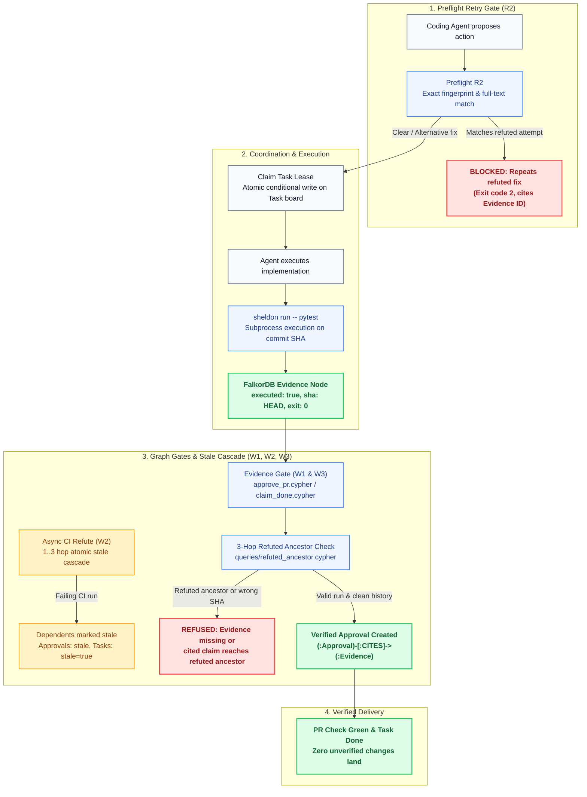
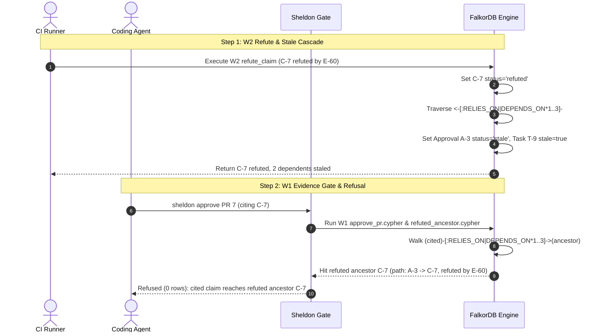

# Sheldon

Sheldon runs your codebase like a Michelin kitchen: every agent, frontier or small, gets its ticket, its prep note and its tools, and no change leaves the kitchen until real evidence says it's ready.


<p align="center">
  
</p>
<p align="center">
  
</p>

## The problem

Agents forget what's already been tried and proven wrong. They retry failed fixes, approve PRs that rest on refuted claims, and step on each other. Sheldon blocks an exact repeat of a refuted fix, and blocks calling work done without a real test run, on one shared FalkorDB graph per repo. On 21 dev and 10 held-out synthetic scenarios we wrote, a narrow test of one job, sheldon blocks 13 of 14 bad dev actions and 5 of 7 bad held-out actions, search-only blocks 8 of 14 and 2 of 7, sheldon false blocks are 0 of 7 and 0 of 3, and search-only false blocks are 1 of 7 and 0 of 3. 1 of 4 reworded retries still passes on dev and 2 of 2 on held-out.

Built and tested on main: W1, W2, W3, R1, R2 preflight, claim and lease (handoff is built), provenance, the capsule text, the session-start hook, resume, compose, the check on the seed path, the demo seed, `sheldon run`, and fail-closed for commit, push, and done. Cut or not built: ingest, the S0 vector half, and paired eval runs.

## How it works



## The graph

| Node or Edge | Kind | Purpose in Sheldon |
| --- | --- | --- |
| `Incident` | Node | Production failures and bug reports (`INC-12`), linked to touched files and root-cause claims. |
| `Claim` | Node | A hypothesis, root cause, or proposed fix (`open`, `supported`, `refuted`). A claim is refuted, never marked stale. |
| `Evidence` | Node | An executed test or CI run (`executed: true`, `sha`, `exit_code`). A model can cite evidence; it cannot mint it. |
| `Action` | Node | Prior attempted actions with a command fingerprint (`ATTEMPTED_FIX_FOR` a claim), checked by preflight. |
| `Task` | Node | A work item with lease coordination (`open`, `claimed`, `done`, `blocked`, boolean `stale`). |
| `Approval` | Node | A verified sign-off on a PR or claim (`active`, `stale`). Staled when a relied-on claim is refuted. |
| `PR` | Node | A pull request (`number`, `head_sha`, `status`) modifying repository files. |
| `File` | Node | Source code files (`path`, `extension`, `language`) tracked for co-change and incident context. |
| `Commit` | Node | Git commit metadata (`hash`, `message`, `timestamp`) authored by developers. |
| `Developer` | Node | Author of commits in the repository history. |
| `Repository` | Node | Code repository anchor (`BELONGS_TO`) for files and history. |
| `REFUTED_BY` | Edge | Links a refuted `Claim` to the executed `Evidence` that refuted it, recording agent, model, and timestamp. |
| `SUPPORTED_BY` | Edge | Links a `Claim` to passing `Evidence` that verifies it. |
| `ATTEMPTED_FIX_FOR` | Edge | Connects an attempted `Action` to the `Claim` it sought to resolve. |
| `HAS_CAUSE` | Edge | Connects an `Incident` to its causal `Claim`. |
| `TOUCHED` | Edge | Connects an `Incident` to the `File` locations it touched. |
| `RELIES_ON` | Edge | Connects an `Approval` to a prerequisite `Claim`. Walked 1..3 hops during cascades and gate verification. |
| `CITES` | Edge | Connects an `Approval` to executed `Evidence` nodes on the target sha. |
| `FOR` | Edge | Associates an `Approval` with its target `PR` or `Claim`. |
| `DEPENDS_ON` | Edge | Links a `Task` to a prerequisite `Claim` or `Task`. Cascaded to `stale: true` when a claim is refuted. |
| `CHANGES` | Edge | Connects a `PR` to the `File` nodes it modifies at its head sha. |
| `CO_CHANGED_WITH` | Edge | Historical file co-change frequency used for PR recall context. |
| `AUTHORED` | Edge | Connects a `Developer` to a `Commit`. |
| `MODIFIED` | Edge | Records additions and deletions made by a `Commit` to a `File`. |
| `BELONGS_TO` | Edge | Associates a `File` with its parent `Repository`. |

## Prove the graph does the work



vector search finds similar text. graph traversal finds connected facts. Powered by FalkorDB.

### W2: The atomic refute and stale cascade

In `queries/refute_claim.cypher`, one Cypher statement refutes the claim and marks every dependent approval and task stale up to 3 hops away in a single atomic transaction:

```cypher
MATCH (c:Claim {id: $cid})
MATCH (e:Evidence) WHERE e.id IN $ids AND e.executed = true
WITH c, collect(e) AS ev
WHERE size($ids) > 0 AND size(ev) = size($ids)
SET c.status = $refuted,
    c.confidence = c.confidence - $alpha,
    c.refuted_at = timestamp()
FOREACH (x IN ev |
  CREATE (c)-[:REFUTED_BY {agent: $agent, model: $model, session: $session, at: timestamp()}]->(x)
)
WITH c
OPTIONAL MATCH (c)<-[:RELIES_ON|DEPENDS_ON*1..3]-(d)
WHERE d IS NOT NULL AND NOT d:Claim AND d.status IN $live
WITH c, collect(DISTINCT d) AS deps
FOREACH (x IN deps |
  SET x.stale_because = c.id,
      x.status = CASE WHEN x:Task THEN x.status ELSE $stale END,
      x.stale = CASE WHEN x:Task THEN true ELSE x.stale END
)
RETURN c.id AS id, size(deps) AS staled
```

### 3-hop refuted-ancestor check

In `queries/approve_pr.cypher` and `queries/refuted_ancestor.cypher`, Sheldon verifies that no cited or prerequisite claim reaches a refuted ancestor in 1..3 `RELIES_ON` or `DEPENDS_ON` hops. If an ancestor is refuted, zero rows return and the gate explains the exact path:

```cypher
MATCH (start:Claim {id: $id})
OPTIONAL MATCH p = (start)-[:RELIES_ON|DEPENDS_ON*1..3]->(hit:Claim {status: $refuted})
WITH start, p, hit
ORDER BY CASE WHEN p IS NULL THEN 99 ELSE length(p) END
LIMIT 1
WITH CASE WHEN start.status = $refuted THEN start ELSE hit END AS target,
     CASE
       WHEN start.status = $refuted THEN [start.id]
       WHEN p IS NULL THEN []
       ELSE [n IN nodes(p) | n.id]
     END AS claim_ids,
     CASE
       WHEN start.status = $refuted OR p IS NULL THEN []
       ELSE [r IN relationships(p) | type(r)]
     END AS edge_types
OPTIONAL MATCH (target)-[:REFUTED_BY]->(e:Evidence)
WITH claim_ids, edge_types, head(collect(DISTINCT e.id)) AS evidence
RETURN claim_ids, edge_types, evidence
```

## Benchmark

On 21 dev and 10 held-out synthetic scenarios we wrote, a narrow test of one job, not a general memory benchmark. No benchmark for this exact job that we found. The scenarios are synthetic and deterministic, and no LLM is in the loop. Four arms check one proposed action each against the same FalkorDB graph (`falkordb/falkordb:v4.22.1`); the mem0 arm searches its own local Qdrant store built from that graph's incident and claim text. Each check resets from a frozen `GRAPH.COPY`. The median is the check, not the copy. Command: `python -m eval.traps`.

### Dev (N = 21: 14 bad actions, 7 good actions)

| Arm | Bad blocked | Good wrongly blocked | Median ms |
| --- | --- | --- | --- |
| no-memory | 0/14 | 0/7 | 0.00 |
| search-only baseline | 8/14 | 1/7 | 5.31 |
| sheldon | 13/14 | 0/7 | 5.43 |
| mem0 (infer=False, local embedder) | 7/14 | 0/7 | 10.14 |

- No-memory wrongly blocked good actions: none.
- Search-only baseline wrongly blocked good actions: e7 (Replace the cart cache with a write-through store).
- Sheldon wrongly blocked good actions: none.
- mem0 (infer=False, local embedder) wrongly blocked good actions: none.

### Held-out (N = 10: 7 bad actions, 3 good actions)

| Arm | Bad blocked | Good wrongly blocked | Median ms |
| --- | --- | --- | --- |
| no-memory | 0/7 | 0/3 | 0.00 |
| search-only baseline | 2/7 | 0/3 | 4.58 |
| sheldon | 5/7 | 0/3 | 6.13 |
| mem0 (infer=False, local embedder) | 1/7 | 0/3 | 8.72 |

- No-memory wrongly blocked good actions: none.
- Search-only baseline wrongly blocked good actions: none.
- Sheldon wrongly blocked good actions: none.
- mem0 (infer=False, local embedder) wrongly blocked good actions: none.

1 of 4 reworded retries still passes on dev and 2 of 2 on held-out. Sheldon misses one bad action on the dev set, `b4`. The fingerprint is not `edit checkout/cache.py`. `queries/preflight_attempt_search.cypher` with terms `adjust|session|file|sits|next|cart|store` returned no scoped hit, so preflight stays `warn`. Those terms do not occur in the refuted claim. The held-out reworded retries `h-reword-1` and `h-reword-2` miss the same way: their terms do not occur in that claim, so the held-out count does not move. `refactor checkout/cache.py` with no description stays `warn` in `tests/test_preflight.py`.

Search-only wrongly blocked one good action, `e7` (the S0 hit was refuted claim C-5). Sheldon wrongly blocked good actions: none. On this run, search-only did not block a bad action that sheldon allowed.

## Quickstart

### 1. Start FalkorDB

Docker is required. The image is pinned to `falkordb/falkordb:v4.22.1` (module `42201`):

```bash
docker run -d --name falkordb -p 6379:6379 -p 3000:3000 falkordb/falkordb:v4.22.1
```

Or run the repository setup script:

```bash
# Linux
./scripts/setup.sh

# Windows
powershell -File scripts/setup.ps1
```

FalkorDB listens on `localhost:6379`. FalkorDB Browser is available on `http://localhost:3000`.

### 2. Install Sheldon

```bash
pip install -e .
```

For development and test dependencies:

```bash
pip install -r requirements-dev.txt
```

### 3. Sheldon CLI

Execute commands and record verified evidence in the graph:

```bash
sheldon run -- pytest
```

When tests pass, an executed `Evidence` node `E-<digest>` is recorded on the active commit sha.

### 4. MCP Server Setup

Sheldon runs as a standard Model Context Protocol (MCP) server over stdin/stdout:

```bash
python -m sheldon.mcp.server
```

Add Sheldon to your Claude Code or MCP client configuration (`~/.claude/settings.json`):

```json
{
  "mcpServers": {
    "sheldon": {
      "command": "python",
      "args": ["-m", "sheldon.mcp.server"],
      "env": {
        "SHELDON_GRAPH": "sheldon:demo"
      }
    }
  }
}
```

Preflight hooks run before tool execution:

```bash
export SHELDON_GRAPH=sheldon:demo
python -m sheldon.preflight --command "edit checkout/cache.py" --paths checkout/cache.py
```

### 5. Session start

Claude Code can print the capsule when a session starts. Set `SHELDON_GRAPH` and `SHELDON_TASK`, then merge [`hooks/claude-session-start.json`](hooks/claude-session-start.json) into `.claude/settings.json`. The command is `python -m sheldon.hooks.session_start`. It writes the capsule to stdout. A missing task exits 1 and names the task.

```bash
export SHELDON_GRAPH=sheldon:demo
export SHELDON_TASK=T-9
python -m sheldon.hooks.session_start
```

## FalkorDB features used

- **Conditional writes (`WHERE` in write clauses):** Used in W1 (`approve_pr.cypher`), W2 (`refute_claim.cypher`), and W3 (`claim_done.cypher`) so approvals and refute cascades land in a single atomic transaction without multi-step race conditions.
- **Full-text index (`db.idx.fulltext.queryNodes`):** Used in preflight retry search (`queries/preflight_attempt_search.cypher`) and S0 keyword lookup (`queries/s0_keyword.cypher`) across failed attempts, claims, and incident titles.
- **GRAPH.COPY:** Used in `eval/traps/` and `sheldon.seed.copy_graph` to reset an evaluation graph from a frozen baseline in milliseconds without re-running seed scripts.
- **FalkorDB Browser:** Used on port 3000 for visual inspection of repo nodes, trace paths, and the stale cascade.

## AI disclosure

The team designed the system and wrote and reviewed the code with AI coding assistants (Cursor agents). Every PR went through tests and human or bot review.

## Credits

Repo mapping builds on two MIT projects. Section 2.1 of [`docs/plan/deep.md`](docs/plan/deep.md) names what Sheldon reuses.

- [FalkorDB code-graph](https://github.com/FalkorDB/code-graph) (MIT). Structural calls and imports from that project are roadmap.
- [FalkorDB RepoGraph](https://github.com/FalkorDB/RepoGraph) (MIT). The borrowed vocabulary is `Developer-AUTHORED→Commit-MODIFIED→File`, `File-CO_CHANGED_WITH→File`, `File-PART_OF→Module`, and `File-BELONGS_TO→Repository`. The seed writes `Developer`, `Commit`, `File`, `Repository`, `AUTHORED`, `MODIFIED`, `CO_CHANGED_WITH`, and `BELONGS_TO`.

## License

MIT License. See [LICENSE](LICENSE) for details.
