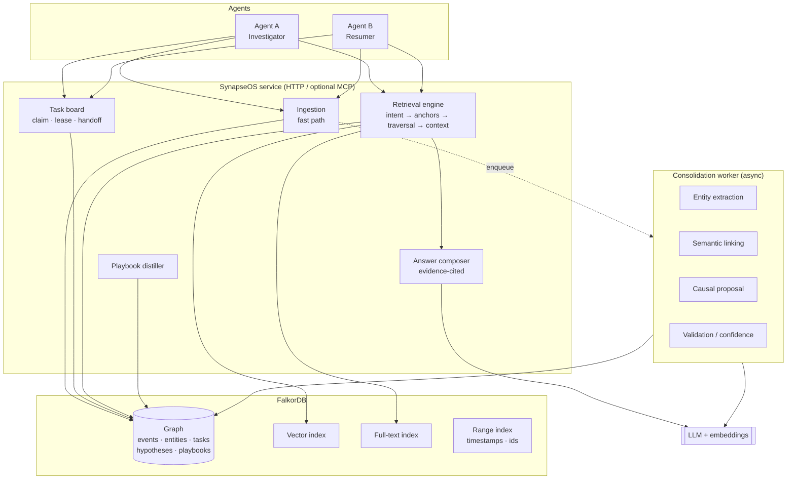

> **Precedence:** [`facts.md`](../facts.md), [`REPORT.md`](../decisions/REPORT.md), and [`papers.md`](../engine/papers.md) override this file.
>
> **Do not quote or implement these. They were disproved:**
> - "vector queries can't combine with filters" — a `WHERE` after `YIELD` runs, but only on the top-k, so recall drops. Per-investigation graphs are a choice, not a requirement (see [`facts.md`](../facts.md)).
> - "no competitor has GRAPH.COPY" — false. It is an eval-reset method, not a novelty claim.
> - MIRIX arXiv `2501.02388` — the id is **`2507.07957`** ("MIRIX: Multi-Agent Memory System for LLM-Based Agents").
> - HippoRAG "+38.6%" — it is **+38.6 points** AR@5 on 2Wiki (37.1 → 75.7), not a relative percent.
> - any personalized-PageRank design — `algo.pageRank` is global only. Personalized PageRank does not exist.
>
> The product name is **Sheldon**. SynapseOS was an earlier name.

# SynapseOS — Architecture & Build Plan

**Persistent, evidence-grounded memory for multi-agent investigations, built on FalkorDB**

*Status: draft v1 · Prepared 15 Oct 2026 · Target: Graph Hacks (WeMakeDevs × FalkorDB), agent-memory track*

---

## 0. Read this first

**One-sentence pitch.** SynapseOS is a shared graph memory and task board that lets one AI agent pick up another agent's incident investigation, with every answer traceable to recorded evidence, without repeating work that already failed.

**Three design rules that drive everything below:**

1. **Events are ground truth; everything else is a labelled inference.** Observations, actions and results are recorded verbatim. Causal links, hypotheses and playbooks are *proposed* until validated, and are always shown as such.
2. **The graph must change what the agent receives.** Retrieval picks anchors with vector/keyword/time signals, then *graph traversal* decides which evidence gets into the context. If you could swap the graph for a flat table and get the same answer, the design has failed the hackathon's "central, not decorative" test.
3. **Measure, don't claim.** Every performance or accuracy statement in the demo comes from our own evaluation harness (§10), never from papers or vendor benchmarks.

---

## 1. Verified facts this design relies on

I checked these against current docs/papers (Oct 2026). Items marked ⚠️ **change the design** relative to the earlier dossier.

| # | Fact | Source | Design impact |
|---|---|---|---|
| 1 | MAGMA's substrate has **four relational views** (semantic, temporal, causal, entity); its **three logical layers** are query process, data structure, write/update. Published at ACL 2026. Retrieval is "policy-guided traversal" that routes by query intent. | arXiv 2601.03236; ACL Anthology 2026.acl-long.1709 | Use the four views as edge families. Episodic/semantic/procedural is *not* MAGMA's taxonomy (see #9). |
| 2 | FalkorDB speaks the Redis protocol and implements a **subset of OpenCypher** plus extensions. Docs warn not to assume Neo4j-only syntax. | docs.falkordb.com | Test every query on a real instance early. Do not copy Neo4j/APOC snippets. |
| 3 | **Vector index**: HNSW, cosine or Euclidean, 1–4096 dims. Query with `CALL db.idx.vector.queryNodes(label, attribute, k, vecf32([...])) YIELD node, score`. Edge vector indexes also exist (`queryRelationships`). | docs.falkordb.com/cypher/indexing/vector-index | Embeddings live on `Event` nodes. |
| 4 | ⚠️ The cheat sheet says vector queries **don't combine well** with property filters. Spike B2 shows a `WHERE` after `YIELD` runs, on the top-k only (see [`facts.md`](../facts.md)). | docs.falkordb.com/cypher/cheat-sheet | Per-investigation graphs are a good choice, not a requirement. An empty filtered vector result can mean "outside the top-k", not "no match". |
| 5 | **Full-text index**: `CREATE FULLTEXT INDEX FOR (n:Label) ON (n.prop)`; query with `db.idx.fulltext.queryNodes(label, string)`. | docs.falkordb.com | Keyword anchors for exact error strings, hostnames, IDs. |
| 6 | ⚠️ `algo.pageRank(label, relationship-type)` exists but is **global PageRank** over a label/edge type. Docs show no seed/personalization parameter. | docs.falkordb.com/algorithms/pagerank | **Personalized PageRank is not available natively.** Do not build on "native PPR". Use bounded traversal + scoring (§6). |
| 7 | Other built-in algos: BFS, shortest paths, WCC, MSF, betweenness, label propagation. | docs.falkordb.com/cypher/procedures | BFS/shortest-path usable for evidence paths; WCC/label-propagation optional for clustering. |
| 8 | ✅ **Every write query is atomic; writes are serialized per graph; reads run in parallel.** No native multi-query transactions (use Redis `MULTI/EXEC` if needed). | docs.falkordb.com/design/concurrency | A *single* conditional `MATCH … WHERE … SET …` is a valid atomic task claim (§7). Don't split claim into read-then-write. |
| 9 | ⚠️ The hackathon's agent-memory track explicitly asks for **episodic, semantic *and procedural*** memory that survives across sessions. | wemakedevs.org/hackathons/falkordb | Drop the idea of skipping procedural memory entirely; ship a **thin** procedural layer (§4.3) so the submission matches the brief. |
| 10 | FalkorDB must be the **primary** graph DB and support a **central** part of the product. Main coding/design work must start **after the hackathon starts**; teams up to 4; dates still "to be announced" at time of writing. | wemakedevs.org/hackathons/falkordb/rules, /schedule | Planning docs are fine; do not write the core implementation before kickoff. Re-check dates. |
| 11 | Writes are the bottleneck under write-heavy load (serialization). | docs.falkordb.com/design/concurrency | Batch ingestion with `UNWIND`; keep the consolidation worker from monopolising the writer. |

**What I could not verify and you should not repeat:** FalkorDB's published latency numbers for *your* workload, any "sub-3 ms retrieval" claim, and the dossier's "20 LLM calls saved." Measure these yourselves.

---

## 2. Scope

### In scope (MVP)
- Two cooperating agents investigating one **simulated software incident** (e.g., checkout latency spike → root cause in a config rollout).
- Event recording with provenance (who, when, session, source).
- Graph consolidation: temporal, entity, semantic and *proposed* causal edges.
- Intent-adaptive retrieval returning **evidence + path**, not just text.
- Shared task board with atomic claim, lease expiry, dependencies, handoff.
- Hypothesis tracking (supported / refuted / open).
- Thin procedural layer: playbooks distilled from *resolved* investigations.
- Evaluation harness with 3 configurations and a fixed question set.
- Minimal UI: graph view (FalkorDB Browser is acceptable) + a handoff/answer panel.

### Out of scope (say so in the README)
- A general agent swarm or scheduler.
- Biological/"cognitive OS" framing.
- Auto-confirming LLM-inferred causal links.
- Multi-tenant auth, production hardening, large-scale data.
- Claims about beating published benchmarks.

---

## 3. System architecture



### Responsibility split

| Component | Owns | Does *not* own |
|---|---|---|
| **FalkorDB** | Persistence, indexes (vector/full-text/range), Cypher traversal, atomic writes | Intent classification, scoring policy, truthfulness of inferred edges |
| **Ingestion (fast path)** | Write the event + temporal edge + embedding, return immediately | Any LLM-inferred relation |
| **Consolidation worker (slow path)** | Entity extraction, semantic links, *proposed* causal edges, confidence | Promoting edges to "confirmed" without a rule or an agent's sign-off |
| **Retrieval engine** | Intent → anchors → bounded traversal → ranked evidence bundle | Writing answers |
| **Answer composer** | Prose answer *with citations to event IDs and the path*; "insufficient evidence" responses | Inventing facts not in the bundle |
| **Task board** | Claims, leases, dependencies, handoff notes | Deciding what's true |

This mirrors MAGMA's split between a fast ingestion path and a slower enrichment path, but the persistence and coordination layers are our own.

---

## 4. Graph data model

### 4.1 Nodes

| Label | Key properties | Purpose |
|---|---|---|
| `Investigation` | `id`, `title`, `status`, `opened_at`, `closed_at` | Scope container |
| `Session` | `id`, `agent_id`, `started_at`, `ended_at` | One agent run; lets us show cross-session continuity |
| `Agent` | `id`, `role` | Who acted |
| `Event` | `id`, `type`, `text`, `ts`, `agent_id`, `session_id`, `source`, `embedding`, `ingest_seq` | **Episodic memory.** `type` ∈ `observation`, `action`, `result`, `decision`, `note` |
| `Entity` | `id`, `kind`, `name`, `aliases` | **Semantic memory.** `kind` ∈ `service`, `host`, `deploy`, `metric`, `error`, `config`, `person` |
| `Hypothesis` | `id`, `statement`, `status`, `confidence`, `opened_by`, `ts` | What we currently believe; `status` ∈ `open`, `supported`, `refuted` |
| `Task` | `id`, `title`, `status`, `owner`, `lease_expires`, `version`, `priority` | Coordination state; `status` ∈ `open`, `claimed`, `done`, `blocked` |
| `Playbook` | `id`, `trigger`, `steps`, `status`, `confidence` | **Procedural memory (thin).** Distilled from resolved investigations |

### 4.2 Relationships (mapped to MAGMA's four views)

| View | Edge | Direction | Key properties | Created by |
|---|---|---|---|---|
| Temporal | `NEXT` | Event → Event | `gap_ms` | Ingestion (deterministic) |
| Entity | `INVOLVES` | Event → Entity | `role` | Worker (LLM extraction) + simple rules (regex for IDs/hosts) |
| Semantic | `RELATED_TO` | Event ↔ Event | `sim` | Worker (embedding similarity above threshold) |
| Causal | `CAUSED_BY` | Event → Event | `status`, `confidence`, `evidence_ids`, `created_by` | Worker (*proposed*); agent or rule (*confirmed*) |
| Causal | `RESULTED_IN` | Event → Event | same as above | Same |
| Provenance | `IN_SESSION`, `IN_INVESTIGATION` | Event → Session / Investigation | — | Ingestion |
| Belief | `SUPPORTED_BY`, `REFUTED_BY` | Hypothesis → Event | `weight` | Agent or worker |
| Coordination | `DEPENDS_ON` | Task → Task | — | Agent / planner |
| Coordination | `INVESTIGATES` | Task → Hypothesis | — | Agent |
| Coordination | `PRODUCED` | Task → Event | — | Agent on completion |
| Procedural | `DERIVED_FROM` | Playbook → Event | — | Distiller |
| Procedural | `APPLIES_TO` | Playbook → Entity | — | Distiller |

**Edge status lifecycle for causal links:** `proposed → confirmed | rejected`. Retrieval *includes* proposed edges but the composer must label them "inferred, unconfirmed." Promotion rules (pick one, keep it simple): (a) an agent explicitly confirms; (b) a deterministic rule fires (e.g., deploy event precedes error onset on the same entity within N minutes *and* a rollback event resolves it); (c) two independent evidence events support it.

### 4.3 How this satisfies "episodic / semantic / procedural"

| Track term | SynapseOS realisation | Honest note |
|---|---|---|
| Episodic | `Event` chain with `NEXT`, sessions, provenance | Core of the MVP |
| Semantic | `Entity` nodes, `INVOLVES`, `RELATED_TO`, `Hypothesis` | Core of the MVP |
| Procedural | `Playbook` nodes distilled from resolved investigations; retrieved when a new incident matches `APPLIES_TO` entities | Keep it small: a handful of playbooks, shown in one demo moment. This is our extension, not something the MAGMA paper establishes. |

### 4.4 Indexes

```cypher
// Range indexes (ordering, lookups)
CREATE INDEX FOR (e:Event) ON (e.ts)
CREATE INDEX FOR (e:Event) ON (e.id)
CREATE INDEX FOR (t:Task)  ON (t.id)
CREATE INDEX FOR (n:Entity) ON (n.name)

// Keyword anchors
CREATE FULLTEXT INDEX FOR (e:Event) ON (e.text)

// Semantic anchors — dimension MUST match your embedding model
CREATE VECTOR INDEX FOR (e:Event) ON (e.embedding)
  OPTIONS {dimension: 768, similarityFunction: 'cosine'}
```

**Scoping decision** (per-investigation graphs are a choice; a vector `WHERE` is a post-cut on the top-k, not a hard ban — see [`facts.md`](../facts.md)):

- *Recommended for MVP:* one FalkorDB graph key per investigation (e.g., `synapse_inc_0042`). Vector/full-text results are automatically scoped. Playbooks live in a separate shared graph (`synapse_playbooks`) and are queried separately.
- *Alternative:* one graph for everything; over-fetch (`k = 5× needed`) and post-filter by `investigation_id`. Simpler schema, noisier results as data grows.

Decide this in week 1; changing it later is painful.

---

## 5. Write path

### 5.1 Fast path (synchronous, ≤ one round-trip budget you set)

1. Agent calls `record_event(investigation, agent, session, type, text, source, refs?)`.
2. Service computes the embedding (or queues it if you want ingest-latency isolation).
3. **One write query** creates the event, attaches it to session/investigation, and links `NEXT` from the previous event in that investigation:

```cypher
MATCH (inv:Investigation {id: $inv})
OPTIONAL MATCH (inv)<-[:IN_INVESTIGATION]-(prev:Event)
WHERE prev.ingest_seq = $prev_seq
CREATE (e:Event {
  id: $id, type: $type, text: $text, ts: $ts, agent_id: $agent,
  session_id: $session, source: $source, ingest_seq: $seq,
  embedding: vecf32($embedding)
})
CREATE (e)-[:IN_INVESTIGATION]->(inv)
FOREACH (_ IN CASE WHEN prev IS NULL THEN [] ELSE [1] END |
  CREATE (prev)-[:NEXT {gap_ms: $gap}]->(e))
RETURN e.id
```

> ⚠️ Treat the `FOREACH … CASE` idiom as *to verify* on your FalkorDB version. If it misbehaves, split into two statements wrapped in `MULTI/EXEC`, or generate `ingest_seq` in the application and link in a second write.

4. Enqueue `event_id` for the worker. Return the event ID.

Use `UNWIND` batching for bulk loads (e.g., when seeding the synthetic incident).

### 5.2 Slow path (asynchronous consolidation worker)

For each queued event (batched, with a short window of preceding events as context):

1. **Entity extraction** → `MERGE` `Entity` nodes (one `MERGE` per clause, per FalkorDB guidance) and `INVOLVES` edges. Add deterministic regex extraction for IDs/hosts/commit SHAs before the LLM sees anything.
2. **Semantic links** → vector-search top-k neighbours; create `RELATED_TO {sim}` above a threshold.
3. **Causal proposals** → LLM is shown the event + its temporal neighbourhood and asked for candidate `CAUSED_BY`/`RESULTED_IN` links, each with a rationale and **cited evidence event IDs**. Reject proposals without valid citations. Store as `status: 'proposed'`.
4. **Confidence & validation** → apply the promotion rules in §4.2.
5. **Hypothesis updates** → attach `SUPPORTED_BY` / `REFUTED_BY` when a new result clearly bears on an open hypothesis.

**Failure behaviour:** the worker can lag or crash without affecting ingestion or correctness of the event log. Retrieval must degrade gracefully to temporal + vector + keyword when richer edges haven't been written yet.

### 5.3 Procedural distillation (thin)

When an investigation closes with a confirmed resolution, one LLM call proposes a `Playbook` (trigger signature, ordered steps, what to avoid), linked via `DERIVED_FROM` to the supporting events. Status starts as `proposed`; a human or agent confirms it. In the demo, a *second* similar incident retrieves it.

---

## 6. Read path: query-adaptive retrieval

### 6.1 Pipeline

```
question ─► intent classifier ─► anchor search ─► bounded traversal ─► scoring ─► evidence bundle ─► answer
            (4 labels)          (vector + FT + time)   (edge-type policy)
```

### 6.2 Intents and traversal policy

| Intent | Example | Anchor emphasis | Edge priority (high → low) | Max hops |
|---|---|---|---|---|
| `timeline` | "What did we try, in order?" | time window + session | `NEXT` → `IN_SESSION` | 2–4 along `NEXT` |
| `entity` | "Everything about `checkout-svc`" | full-text/entity match | `INVOLVES` → `RELATED_TO` | 2 |
| `causal` | "Why did the rollback fail?" | vector + full-text | `CAUSED_BY`/`RESULTED_IN` → `NEXT` → `INVOLVES` | 3 |
| `recall` (default) | "What do we know about the DB pool?" | vector + full-text | `RELATED_TO` → `INVOLVES` → `NEXT` | 2 |
| *(overlay)* `state` | "What do we currently believe? What's next?" | `Hypothesis` + open `Task` | `SUPPORTED_BY`/`REFUTED_BY`, `DEPENDS_ON` | 2 |

Start with a rule-based or small-LLM classifier over these labels; it only has to be right often enough to beat a no-intent baseline (you'll measure that in §10).

### 6.3 Anchor selection

1. Run `db.idx.vector.queryNodes('Event','embedding', $k, vecf32($q))`.
2. Run `db.idx.fulltext.queryNodes('Event', $keywords)`.
3. For timeline questions, add events inside the requested time window via the range index.
4. Merge and normalise scores; keep top-N anchors (N ≈ 5–8; tune).

### 6.4 Bounded traversal

Expand only along the intent's edge types with a hard hop and node budget. Example for a causal question:

```cypher
MATCH p = (a:Event {id: $anchor})-[:CAUSED_BY|RESULTED_IN*1..3]-(b:Event)
WHERE NOT (b)-[:REJECTED]-()          // illustrative; model rejection via status on the edge
RETURN p
LIMIT $budget
```

> ⚠️ Verify variable-length patterns with multiple relationship types and edge-property filters on your FalkorDB version. If a filter on `status` isn't supported inside the pattern, filter on the returned path or use `[r:CAUSED_BY*1..3]` per type and union in the app.

### 6.5 Scoring (do this in the application — simple and inspectable)

```
score(event) = w_anchor · anchor_score
             + w_hop    · decay(hop_distance)
             + w_edge   · edge_type_weight[intent]
             + w_time   · recency_or_window_match
             + w_conf   · (1.0 confirmed | 0.6 proposed)
```

Pick weights by hand first; tune on a *dev* split of your question set, report on a *held-out* split. This is a deliberately simple stand-in for MAGMA's adaptive traversal policy, and it avoids the unavailable "native Personalized PageRank." Do not build a PageRank-style spreader. Personalized PageRank is not in the engine, and a hand-rolled version is out of scope.

### 6.6 Evidence bundle (what the LLM is allowed to use)

```json
{
  "question": "...",
  "intent": "causal",
  "events": [{"id": "ev_031", "ts": "...", "agent": "A", "type": "result", "text": "..."}],
  "paths": [["ev_029", "CAUSED_BY[proposed,0.7]", "ev_024"]],
  "hypotheses": [{"id": "h_2", "status": "refuted", "supported_by": [], "refuted_by": ["ev_031"]}],
  "open_tasks": [{"id": "t_5", "title": "...", "depends_on": ["t_4"]}],
  "coverage": {"anchors": 6, "expanded": 19, "dropped_by_budget": 4}
}
```

### 6.7 Answer composer rules

- Every factual claim cites event IDs.
- Distinguish **recorded** (events), **inferred** (proposed edges), and **hypothesis** (agent belief).
- If the bundle doesn't support a conclusion, say so explicitly. Include a test for this ("What was the customer impact in EU?" when no event mentions it).
- Return the path so the UI can highlight it in the graph.

---

## 7. Coordination: shared task board

### 7.1 Why FalkorDB fits
Tasks, dependencies, ownership and the evidence they produce are graph-shaped, and **FalkorDB serializes writes per graph and makes each write query atomic** (verified, §1 #8). That makes a single conditional update a safe claim primitive.

### 7.2 Atomic claim (single write query)

```cypher
MATCH (t:Task {id: $tid})
WHERE (t.status = 'open' OR (t.status = 'claimed' AND t.lease_expires < $now))
OPTIONAL MATCH (t)-[:DEPENDS_ON]->(d:Task) WHERE d.status <> 'done'
WITH t, count(d) AS blockers
WHERE blockers = 0
SET t.status = 'claimed', t.owner = $agent,
    t.lease_expires = $now + $ttl, t.version = t.version + 1
RETURN t.id, t.version
```

- **No row returned ⇒ claim failed** (already owned, lease live, or blocked). The agent must not proceed.
- Use `$now` from one clock source (the service), not each agent's.
- **Required test:** fire N concurrent claims at the same task; exactly one must succeed. Do not assume this passes; prove it.

### 7.3 Lifecycle

```
open ──claim──► claimed ──complete──► done
  ▲                │
  └──lease expiry──┘            blocked (derived from DEPENDS_ON)
```

- `heartbeat(task)` extends the lease (conditional on `owner = $agent`).
- `complete(task, findings)` records result `Event`s, links `PRODUCED`, updates any `Hypothesis`, and sets `done` in one query where possible.
- `handoff(task, to_agent, note)` writes a `decision` event with a summary and releases the lease; the receiving agent's first call is `resume(investigation)`, which runs the `state` intent (§6.2).

### 7.4 What "no repeated work" means operationally
Before starting a task, an agent calls `check_prior_attempts(task)`, which runs a causal/timeline retrieval for the task's entities and returns prior `action`→`result` pairs. The harness counts an attempt as *duplicated* if an agent performs an action semantically equal to a prior failed action without a stated reason to retry.

---

## 8. Service interface

Keep the surface small. HTTP (FastAPI-style) first; an MCP wrapper over the same functions is a cheap bonus that makes the agents' tool use look natural.

| Function | Purpose |
|---|---|
| `open_investigation(title)` / `close_investigation(id, resolution)` | Lifecycle; close triggers playbook distillation |
| `record_event(...)` | Fast-path ingestion |
| `recall(question, investigation, [intent])` | Retrieval → evidence bundle (+ optional composed answer) |
| `resume(investigation, agent)` | Handoff briefing: attempted / failed / believed / next |
| `create_task`, `claim_task`, `heartbeat`, `complete_task`, `handoff` | Coordination |
| `propose_hypothesis`, `link_evidence`, `confirm_edge`, `reject_edge` | Belief and validation |
| `graph_view(investigation)` | Data for the UI / FalkorDB Browser |

---

## 9. Suggested stack (choices, not requirements)

| Layer | Suggestion | Notes |
|---|---|---|
| Graph DB | FalkorDB via Docker or FalkorDB Cloud | Both accepted by the hackathon rules |
| Client | Official Python `falkordb` client | Always use **parameterised** Cypher; never string-format LLM output into queries |
| Service | Python + FastAPI | Async worker via `asyncio` task queue; Redis is already available if you want a durable queue |
| LLM | Any strong model via API (Claude is a fine choice) | Pin one model per role (extractor, composer, judge); log prompts/outputs for the eval |
| Embeddings | Any model; **fix the dimension first** | Index dimension must match; re-embedding later means rebuilding the index |
| UI | FalkorDB Browser + a small web panel for handoff/answers | Don't spend days on UI; the graph view *is* the pitch |
| Eval | Plain Python scripts + a JSONL question set | Keep it runnable with one command |

Optional reference: FalkorDB's own GraphRAG SDK shows idiomatic storage and index patterns. Read it for conventions, but don't build the submission *on* it — the original work should be ours.

### Suggested repository layout

```
synapseos/
├── README.md                 # pitch, quickstart, honest limitations
├── docs/ARCHITECTURE.md      # this file
├── src/
│   ├── api/                  # HTTP + optional MCP
│   ├── memory/
│   │   ├── schema.py         # labels, indexes, constraints
│   │   ├── ingest.py         # fast path
│   │   ├── worker.py         # consolidation
│   │   ├── retrieve.py       # intent, anchors, traversal, scoring
│   │   ├── answer.py         # composer + citation checks
│   │   └── playbooks.py
│   ├── tasks/board.py        # claim, lease, handoff
│   ├── agents/               # Agent A / Agent B demo drivers
│   └── llm/                  # clients, prompts (versioned)
├── eval/
│   ├── incident/             # synthetic incident generator + fixed seed data
│   ├── questions.jsonl       # question, gold answer, gold evidence IDs
│   ├── baselines/            # vector+keyword only
│   └── run_eval.py
└── tests/
    ├── test_claim_race.py    # concurrent claims
    └── test_cypher_compat.py # every query used, run against a real FalkorDB
```

---

## 10. Evaluation plan

### 10.1 Dataset
A **fixed, seeded synthetic incident** (≈150–300 events across ≥3 sessions and 2 agents) containing:
- ≥3 failed hypotheses with recorded reasons,
- time-dependent findings (a metric that changed after a deploy),
- at least one *misleading* semantically-similar event (to punish similarity-only retrieval),
- tasks with dependencies,
- a final confirmed resolution,
- a few **unanswerable** questions.

Write the gold answers and gold evidence IDs *before* running any system. Split questions into dev and held-out.

### 10.2 Question mix (~40 total)

| Type | Count | Example |
|---|---|---|
| Timeline | 8 | "List attempted fixes in order." |
| Causal | 10 | "Why did the pool-size increase not help?" |
| Entity | 6 | "Which events involved `payments-db`?" |
| State / next-step | 8 | "What is still unresolved and what should Agent B do next?" |
| Unanswerable | 4 | "Which customers in EU were affected?" |
| Procedural (second incident) | 4 | "Is there a known fix pattern for this?" |

### 10.3 Systems compared

| ID | System | Purpose |
|---|---|---|
| **S0** | Vector + keyword over raw events, no graph | Baseline |
| **S1** | Graph memory: all edges, fixed traversal (no intent routing) | Does graph structure help? |
| **S2** | S1 + intent-adaptive traversal | Does adaptivity help? |
| **S3** | S2 + shared task board + handoff | Full SynapseOS; tests continuation and duplication |

### 10.4 Metrics

| Metric | How measured |
|---|---|
| Answer correctness | Rubric/LLM-judge against gold, spot-checked by a human on a sample |
| Evidence-path correctness | Overlap between returned event IDs/paths and gold evidence IDs (precision/recall) |
| Unsupported-claim rate | Claims in answer not backed by cited events |
| Abstention accuracy | Correct "insufficient evidence" on unanswerable questions |
| Duplicated steps | Count in the two-agent handoff run (S3 vs a no-memory control) |
| Latency | **Report separately:** graph query time vs end-to-end (LLM included) |
| Tokens per query | Context size passed to the composer |

### 10.5 Ablations (mirroring the MAGMA paper's logic)
Run S2 with: no causal edges; no temporal edges; no intent routing; proposed-edges excluded; Python PPR-style scoring instead of the hand scorer. Report what each removal costs. The paper's own ablations are *hypotheses to test*, not results we inherit.

### 10.6 Reporting rules
- State the dataset is synthetic and small.
- Report variance (repeat LLM-dependent runs ≥3×).
- No claims like "eliminates hallucinations."

---

## 11. Risks and mitigations

| Risk | Likelihood | Mitigation |
|---|---|---|
| Wrong inferred causal edges mislead Agent B | High | Citations required; `proposed` status; labelled in answers; eval metric for unsupported claims |
| FalkorDB Cypher subset surprises us | Medium | `test_cypher_compat.py` on day 1–2; keep queries simple; fallbacks noted in §5–6 |
| Vector-filter limitation pollutes results | Medium | Graph-per-investigation scoping (§4.4) |
| Scope creep (swarm, UI polish, procedural engine) | High | §2 out-of-scope list; weekly cut-line review |
| LLM latency dominates and the demo feels slow | Medium | Pre-compute worker enrichment; show graph-query time and end-to-end separately; cache composer calls in eval |
| Claim race condition | Medium | Single-query claim + concurrency test; lease expiry |
| Rules compliance (new work after kickoff; dates TBA) | Medium | Re-check the schedule; keep pre-kickoff output to planning docs and spikes you're happy to discard |
| "It's just MAGMA on another DB" | Medium | Make the original contribution explicit: **cross-agent handoff with evidence-grounded continuation, validated causal links, and the coordination board** |

---

## 12. Build plan (phases, not dates — kickoff is TBA)

Assuming a team of up to 4. Treat each phase as a gate: don't start the next until the exit check passes.

| Phase | Deliverables | Exit check |
|---|---|---|
| **P0 — Spike (day 1)** | FalkorDB running; create indexes; run one vector, one full-text, one variable-length, one atomic-claim query | All §1 assumptions marked ⚠️ confirmed or replaced |
| **P1 — Event memory** | Schema, ingestion, embeddings, `NEXT` edges; seeded synthetic incident; S0 baseline | Can recall events by timeline and similarity; baseline numbers recorded |
| **P2 — Graph retrieval** | Entity/semantic edges, intent classifier, bounded traversal, scorer, evidence bundle | S1 vs S0 comparison on dev questions |
| **P3 — Answers with evidence** | Composer with citations, abstention, path highlighting | Unanswerable questions handled; citation checker passes |
| **P4 — Coordination** | Task board, atomic claim, lease, handoff, `resume` | Concurrency test passes; Agent B resumes without repeating failed steps |
| **P5 — Consolidation & causal** | Async worker, proposed causal edges, validation rules, hypotheses | Causal questions improve (or we report that they didn't) |
| **P6 — Procedural (thin)** | Playbook distillation + second incident | One convincing retrieval of a playbook |
| **P7 — Eval & demo** | S0–S3 results, ablations, README, 3-minute demo | Held-out results in hand; limitations section written |

**Cut order if time runs out:** P6 → P5's ablations → UI polish → MCP wrapper. Never cut P4 or the eval.

---

## 13. Demo script (3 minutes)

1. **Setup (20s):** Show the incident and the empty-ish graph in FalkorDB Browser.
2. **Agent A works (40s):** Records observations, a failed hypothesis, a failed fix. Graph grows live; a proposed causal edge appears (dashed).
3. **Hard stop (10s):** Kill Agent A's session.
4. **Agent B resumes (60s):** Calls `resume`. Answers four questions on screen: *What have we tried? Why did it fail? What do we believe? What's next?* — each with highlighted evidence paths. Show one **"insufficient evidence"** answer.
5. **Race (15s):** Two agents claim the same task; exactly one wins.
6. **Proof (35s):** One results slide: S0 vs S3 on correctness, evidence-path accuracy, duplicated steps; state latency honestly.

---

## 14. Open decisions for the team

1. **Graph scoping:** per-investigation graphs (recommended) vs one shared graph?
2. **Embedding model & dimension** (lock before creating the index).
3. **Promotion rule** for causal edges: agent-confirmed, rule-based, or two-evidence?
4. **Incident scenario:** pick one with a non-obvious root cause and a plausible but wrong first hypothesis.
5. **Roles:** who owns schema/worker, retrieval, coordination, eval/demo?
6. **LLM-as-judge** policy: which model, what rubric, how much human spot-checking?

---

## 15. References

- MAGMA: Jiang, Li, Li, Li. *MAGMA: A Multi-Graph based Agentic Memory Architecture for AI Agents.* ACL 2026 (long papers); arXiv:2601.03236 — https://arxiv.org/abs/2601.03236
- FalkorDB Cypher cheat sheet — https://docs.falkordb.com/cypher/cheat-sheet
- FalkorDB vector index — https://docs.falkordb.com/cypher/indexing/vector-index
- FalkorDB procedures — https://docs.falkordb.com/cypher/procedures
- FalkorDB PageRank — https://docs.falkordb.com/algorithms/pagerank
- FalkorDB atomicity & concurrency — https://docs.falkordb.com/design/concurrency
- Graph Hacks (WeMakeDevs × FalkorDB): overview, rules, schedule — https://www.wemakedevs.org/hackathons/falkordb

*Re-verify the hackathon rules and schedule before kickoff; both are marked as subject to change.*
